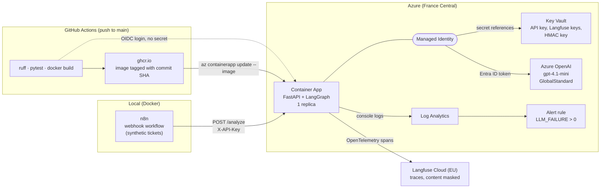
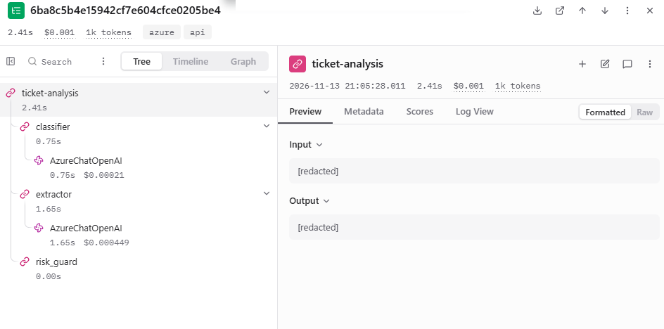
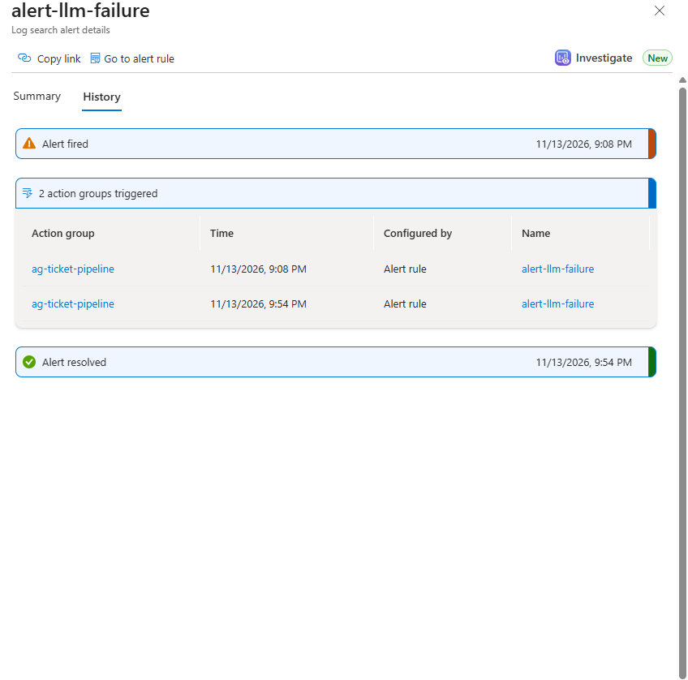

# Hybrid AI Orchestrator

> Automated backoffice ticket processing through hybrid Low-Code + Pro-Code AI architecture.
> Runs on-premise with a local model, or as a demo on Azure with the same code.

[](https://github.com/SuleimanAlbalkhi/langgraph-ticket-pipeline/actions/workflows/ci.yml)


---

## Two run modes

The pipeline code is the same in both modes; `LLM_PROVIDER` selects the model backend.

| | **Local** | **Cloud** |
|---|---|---|
| Purpose | On-premise operation | Demo of a cloud deployment |
| Model | `qwen2.5:3b` via Ollama on the host | `gpt-4.1-mini` on Azure OpenAI, deployment type **GlobalStandard** (France Central) |
| Data | Real tickets possible — no data leaves the host, **GDPR-compliant by design** | **Synthetic data only** — GlobalStandard may process requests in any Azure region worldwide |
| Runs on | Docker Compose (FastAPI + n8n) | Azure Container Apps, deployed by GitHub Actions |
| Auth to the model | none (local) | Managed Identity, no API keys |
| Observability | Container logs | Langfuse traces (masked), Log Analytics alert on `LLM_FAILURE` |

The GDPR statement applies to the **local mode only**. Real customer data in the cloud would need an
EU-bound deployment (Data Zone / Standard) and a data processing agreement — see [Next](#status--roadmap).

## Architecture



In local mode the same FastAPI container runs next to n8n in Docker Compose and calls Ollama on the
host instead of Azure OpenAI. Inside the service, both modes run the same pipeline:

```
   ┌──────────────────┐       ┌──────────────────────┐       ┌─────────────────────┐
   │  Source Systems  │       │   n8n (Low-Code)     │       │  FastAPI Service    │
   │                  │       │                      │       │                     │
   │  • Email         │──────▶│  • Webhook receiver  │──────▶│  • REST API         │
   │  • Web Forms     │       │  • Switch routing    │       │  • Pydantic models  │
   │  • CRM/ERP       │       │  • Slack / Notion    │       │  • LangGraph core   │
   └──────────────────┘       └──────────────────────┘       └──────────┬──────────┘
                                                                        │
                                                                        ▼
                                                       ┌──────────────────────────────┐
                                                       │   LangGraph Pipeline          │
                                                       │                              │
                                                       │   Node 1: Classifier         │
                                                       │   Node 2: Extractor          │
                                                       │      + Grounding (no LLM)    │
                                                       │   Node 3: Risk Guard         │
                                                       │      (Keyword + LLM)         │
                                                       └──────────────┬───────────────┘
                                                                      │
                                                                      ▼
                                                       ┌──────────────────────────────┐
                                                       │  local: Ollama qwen2.5:3b    │
                                                       │  cloud: Azure OpenAI         │
                                                       │         gpt-4.1-mini         │
                                                       └──────────────────────────────┘
```

| Layer | Responsibility | Technology |
|---|---|---|
| **Orchestration** | Webhooks, routing, integrations with ERP/CRM/Slack | n8n |
| **Service** | REST API, contract validation, container boundary | FastAPI + Pydantic |
| **Reasoning** | Classification, extraction, risk evaluation | LangGraph + Ollama / Azure OpenAI |

---

## Demo

### n8n Workflow with risk-based routing


### FastAPI response on a high-risk ticket


### Containerized services


---
## The Problem

Modern enterprises face a dilemma when automating AI-driven processes:

- **Pure pro-code solutions** (e.g. everything in Python) produce unmaintainable code mountains —
  business analysts can't read or adjust the flow.
- **Pure low-code solutions** hit a wall when complex agentic logic is required —
  cyclic decision graphs, self-correction loops, or stateful reasoning.

This project demonstrates the **middle path**: a clean architectural boundary between
the operational layer and the reasoning layer.

---

## Key Features

- **3-Node LangGraph Pipeline** with typed state, linear: classifier → extractor → risk guard
- **Single deterministic classifier run** (`temperature=0`) — self-consistency voting with 3 runs was measured and dropped: the votes were almost always unanimous, so the confidence carried no signal, while costing latency (see [Evaluation](#evaluation))
- **Deterministic post-processing of extracted fields** — values must appear in the ticket text at word boundaries (grounding), slightly garbled names are snapped to the matching text span, signatures like "Einkauf, Firma GmbH" are rejected as customer names, a regex fallback catches deadlines
- **2-Stage Risk Guard** — keyword floor (threat words only, no anger words) plus an LLM call that only fires on a keyword hit or high/critical urgency
- **Defense-in-Depth Validation** — Pydantic input contracts + enum coercion + async timeouts + coercion of list values from the LLM
- **Measured, not assumed** — labeled dev and holdout sets, one change per eval run, tests and CI on every push
- **Two model backends, one code path** — Ollama locally, Azure OpenAI in the cloud; switched by configuration, not by code
- **Cloud deployment without stored secrets** — OIDC from GitHub Actions, Managed Identity to Azure OpenAI and Key Vault
- **Masked tracing and an outage alert** — Langfuse traces without ticket content, alert on model failures
- **Singleton LLM Connections** — no per-request setup overhead
- **Container-Native** — single-stage, layer-cached Docker build, healthcheck-instrumented, docker-compose orchestrated
- **Hybrid Architecture** — n8n exposes business logic visually for non-developers

---

## Evaluation

All numbers below are copied from [`eval/runs/COMPARISON.md`](eval/runs/COMPARISON.md), except the
local row of the first table (recounted on 30 tickets by the pre-registered rule); every experiment,
including the rejected ones, is documented in [`eval/EXPERIMENTS.md`](eval/EXPERIMENTS.md).

**Holdout — local model vs. cloud model** (30 tickets not used during development, one pre-registered
cloud run, 2026-11-15)

| | Category | Urgency | Risk recall | Risk precision | Customer name | Invented name | Latency median / p95 |
|---|---|---|---|---|---|---|---|
| Local: qwen2.5:3b (`0bcbf8f`) | 23 / 30 (77 %) | 14 / 30 (47 %) | 7 / 7 (100 %) | 7 / 9 (78 %) | 12 / 15 (80 %) | 0 / 15 (0 %) | 16.8 / 20.6 s |
| Cloud: gpt-4.1-mini + prompt e11 | 26 / 30 (87 %) | 27 / 30 (90 %) | 7 / 7 (100 %) | 7 / 7 (100 %) | 15 / 15 (100 %) | 0 / 15 (0 %) | 2.2 / 2.9 s |

Model and prompt changed together and are measured together; the run does not separate their effects.
One local ticket returned HTTP 500 (since fixed) and counts as wrong, as fixed before the run. Local
latency is a laptop GPU, cloud latency includes the network path. 0 model failures in the cloud run.

**Holdout — prompt and post-processing changes on the local model** (29 evaluated: one ticket
returned HTTP 500 in both versions, since fixed, see EXPERIMENTS.md)

| | Category | Urgency | Risk recall | Risk precision | Customer name | Invented name | Latency median / p95 |
|---|---|---|---|---|---|---|---|
| Baseline (`da59602`) | 23 / 29 (79 %) | 15 / 29 (52 %) | 7 / 7 (100 %) | 7 / 9 (78 %) | 12 / 14 (86 %) | 0 / 15 (0 %) | 21.0 / 25.6 s |
| Final (`0bcbf8f`) | 23 / 29 (79 %) | 14 / 29 (48 %) | 7 / 7 (100 %) | 7 / 9 (78 %) | 12 / 14 (86 %) | 0 / 15 (0 %) | 16.8 / 20.6 s |

**Dev set — 50 tickets used to select the changes** (context only)

| | Category | Urgency | Risk recall | Risk precision | Customer name | Invented name | Latency median / p95 |
|---|---|---|---|---|---|---|---|
| Baseline (`da59602`) | 40 / 50 (80 %) | 20 / 50 (40 %) | 10 / 11 (91 %) | 10 / 13 (77 %) | 23 / 25 (92 %) | 2 / 25 (8 %) | 20.4 / 25.4 s |
| Final (run `e6e7-names`) | 42 / 50 (84 %) | 26 / 50 (52 %) | 9 / 11 (82 %) | 9 / 10 (90 %) | 25 / 25 (100 %) | 0 / 25 (0 %) | 17.1 / 21.8 s |
| Cloud (run `e11-risk-anger`) | 49 / 50 (98 %) | 40 / 50 (80 %) | 11 / 11 (100 %) | 11 / 11 (100 %) | 25 / 25 (100 %) | 0 / 25 (0 %) | 2.3 / 3.2 s |

**The prompt gains on the local model did not carry over to the holdout set.** Category, risk and
customer name are identical on the holdout, urgency is one ticket lower (within the noise band). The
one improvement that did carry over is latency: −20 % (median 21.0 → 16.8 s), from running the
classifier once instead of three times. **The switch to the cloud model did carry over:** the dev-set
gap (category +7, urgency +14) shows up on the holdout as category +3, urgency +13.

**Method.** Dev and holdout sets were kept separate: the dev set was committed before the first
measurement, the holdout set after the first baseline run but before the first experiment. It was
used for the local final run and once more for a single cloud run whose metrics and comparison rule
were committed before the run. The noise threshold comes
from two identical baseline runs (same code, same image): 1 category and 2 urgency tickets
flipped, so a change only counted at ≥ 3 tickets for category/urgency and ≥ 1 ticket for risk
and name. Every experiment was one change and one full run, with a rebuilt Docker image checked
against the code (cloud: the commit reported by `/ready`). Rejected experiments are kept with their
run and patch (`eval/patches/`).

Local: `qwen2.5:3b` via Ollama · GTX 1050 Ti 4 GB (Laptop), Intel i7-7700HQ, 16 GB RAM · 2026-10-30.
Cloud: `gpt-4.1-mini` (2025-04-14) on Azure OpenAI, GlobalStandard, France Central · 2026-11-15.

**Reproduce** (from the repo root):

```powershell
pip install -r eval/requirements.txt
docker compose up -d --build fastapi-service
python eval/run_eval.py --run-name my-run --hardware "<your GPU / CPU / RAM>"
python eval/report.py --run my-run          # writes eval/runs/my-run/RESULTS.md
python eval/compare.py                      # updates eval/runs/COMPARISON.md
```

`run_eval.py --tickets eval/holdout/tickets.jsonl` runs the holdout set instead of the dev set.
Against a deployed service: `--base-url https://<app> --verify-via-ready`, API key in `EVAL_API_KEY`.

---

## Deployment

The cloud mode runs on Azure Container Apps. Step-by-step setup, including the portal equivalents:
[`docs/azure-setup.md`](docs/azure-setup.md). Every design choice with its reason:
[`DECISIONS.md`](DECISIONS.md).

- **Build and deploy:** every push to `main` runs lint and tests, builds the image, pushes it to
  ghcr.io tagged with the commit SHA and updates the Container App. GitHub logs in to Azure via
  **OIDC** (federated credential, scoped to this repo and `main`) — there is no Azure secret in GitHub.
  The job waits until `/ready` reports the new commit; rollback is an update to the previous image tag.
- **Runtime identity:** the Container App has a system-assigned **Managed Identity**. It reads the API
  key, the Langfuse keys and the HMAC key from **Key Vault** (secret references) and gets an Entra ID
  token for Azure OpenAI. API-key authentication on the Azure OpenAI resource is disabled.
- **Model:** `gpt-4.1-mini` as deployment `ticket-llm`, GlobalStandard, capacity 10k tokens per minute
  as a hard cost limit (raised to 100k only for eval runs).
- **API protection:** `POST /analyze` requires the `X-API-Key` header. Load shedding answers `503`
  with `Retry-After: 5`; the n8n node retries three times.

**Cost per ticket:** about **$0.0008** (0.000813 USD) — Langfuse estimate at list price, gpt-4.1-mini,
as of 11/2026, averaged over the 30 holdout traces.
**Latency:** median 2.2 s, p95 2.9 s per ticket on the holdout set, measured from the eval client.

---

## Observability

**Tracing.** Every analysis becomes a trace in Langfuse Cloud (EU region): one span per node, one
generation per LLM call with model, tokens, latency and cost. Content is **masked by default**:
inputs and outputs are replaced by `[redacted]` before export, and an allowlist drops every other
attribute that is not known to be safe. Traces carry release (commit SHA), environment
(`local` / `production`), tags and a keyed hash of the ticket ID instead of the ID itself.



**Alerting.** Model failures do not cause HTTP errors — the nodes fall back to safe defaults and
`/analyze` still answers 200. Each failed LLM call therefore writes a log line `LLM_FAILURE`, and a
Log Analytics alert fires on any such line within 15 minutes. In testing the alert fired twice and
resolved automatically both times:

- **18:53**, from an earlier test run: two tickets at 18:47/18:48, each with 2 `LLM_FAILURE` lines
  (classifier + extractor, `reason=error`).
- **21:08**, planned alert test: one ticket at 21:03 against a non-existent deployment name. Resolved
  at 21:54; the action group was triggered on fire and on resolve.

No model failure since then, including the 30-ticket holdout run.



**Known limitation:** delivery of the notification by e-mail and push fails in the student Azure
tenant. The alert rule and the action group demonstrably trigger; only the delivery to recipients
does not work, so the alert is checked in the portal.

---

## Quick Start

### Prerequisites

- Docker Desktop (with WSL 2 backend on Windows)
- Ollama installed on host with `qwen2.5:3b` pulled:
  ```powershell
  ollama pull qwen2.5:3b
  ```

### Run (local mode)

```powershell
git clone https://github.com/SuleimanAlbalkhi/langgraph-ticket-pipeline.git
cd langgraph-ticket-pipeline
docker compose up -d
```

That's it. Two containers come up:

| Service | URL | Purpose |
|---|---|---|
| FastAPI | http://localhost:8000/docs | API + Swagger UI |
| n8n | http://localhost:5678 | Workflow editor |

### Verify

```powershell
curl http://localhost:8000/health
# {"status":"ok","service":"Hybrid AI Orchestrator"}
```

### Import the n8n workflows

- `n8n-workflows/Ticket-Analysis-Pipeline.json` — local mode, calls `http://fastapi-service:8000/analyze`.
- `n8n-workflows/Ticket-Analysis-Pipeline-Cloud.json` — cloud mode, synthetic tickets only. Before
  importing, create a **Header Auth** credential named exactly **`Ticket-Pipeline Cloud`** with header
  `X-API-Key` and the API key as value; the workflow references the credential by that name. Replace
  the URL in the HTTP node with your own Container App. Start n8n alone with
  `docker compose up -d --no-deps n8n`.

---

## API Reference

### `POST /analyze`

Processes a single ticket end-to-end through the LangGraph pipeline. Requires the header
`X-API-Key` when `API_KEY` is set (always in the cloud).

**Request**

```json
{
  "ticket_id": "T-001",
  "raw_text": "Einspruch gegen Rechnung RE-2026-0481 über 1.247,80 EUR. Sollte dies nicht innerhalb von 14 Tagen geklärt werden, schalte ich meinen Anwalt ein.",
  "source": "email"
}
```

**Response**

```json
{
  "ticket_id": "T-001",
  "category": "billing_dispute",
  "urgency": "critical",
  "summary": "Kunde erhebt Einspruch gegen Rechnung und droht mit anwaltlicher Eskalation.",
  "extracted_data": {
    "customer_name": null,
    "product": null,
    "error_code": null,
    "invoice_number": "RE-2026-0481",
    "amount": "1.247,80 EUR",
    "deadline_mentioned": true,
    "deadline": "innerhalb von 14 Tagen"
  },
  "risk_flag": true,
  "risk_reason": "rechtliche Drohungen, Eskalationsabsicht",
  "confidence_score": 1.0
}
```

> `confidence_score` is the agreement rate of the classifier runs. Since the
> classifier runs once (`N_VOTES=1`), it is always `1.0` (`0.0` only if the run
> fails) — see [Limitations](#limitations). `deadline` is filled by the LLM, with a
> regex post-processor as a deterministic fallback.

Measured latency on the holdout set per ticket: **local median 16.8 s, p95 20.6 s** (GTX 1050 Ti
(Laptop), qwen2.5:3b; the extractor dominates) — **cloud median 2.2 s, p95 2.9 s** (gpt-4.1-mini).

### `GET /health`

Liveness probe: answers whether the process is up, checks no dependencies.

### `GET /ready`

Readiness probe: checks the configuration and, in cloud mode, that the Managed Identity gets a token
for Azure OpenAI — without a model call, so probes cost no tokens. Returns the deployed commit
(`git_sha`), which the deploy job and the eval script use to verify what is running.

---

## Project Structure

```
hybrid-ai-orchestrator/
├── fastapi-service/
│   ├── app/
│   │   ├── main.py              FastAPI app + lifespan + endpoints + API-key check
│   │   ├── config.py            Pydantic Settings (env-driven, LLM_PROVIDER ollama | azure)
│   │   ├── observability.py     Langfuse tracing, masking allowlist, ticket-ID HMAC
│   │   ├── models/ticket.py     Input/Output contracts + enums
│   │   └── graph/
│   │       ├── orchestrator.py  LangGraph definition (linear) + egress coercion
│   │       ├── state.py         GraphState + fallback summaries
│   │       ├── llm_utils.py     LLM client factory (Ollama / Azure) + invoke_json
│   │       ├── postprocess.py   Grounding, snap to text, organisation filter, deadline regex
│   │       ├── prompt_safety.py Fencing of untrusted ticket text
│   │       ├── prompts/         One prompt builder per node (snapshot-tested)
│   │       └── nodes/
│   │           ├── classifier.py   Node 1: category + urgency
│   │           ├── extractor.py    Node 2: summary + structured data
│   │           └── risk_guard.py   Node 3: keyword floor + LLM risk evaluation
│   ├── tests/                   pytest suite (LLM always mocked)
│   ├── Dockerfile               Multi-layer cached build
│   ├── requirements.txt
│   └── requirements-dev.txt     pytest, pytest-asyncio, ruff
├── eval/
│   ├── tickets.jsonl            Dev set (50 labeled tickets)
│   ├── holdout/tickets.jsonl    Holdout set (30 labeled tickets)
│   ├── run_eval.py / report.py / compare.py
│   ├── runs/                    One folder per eval run + COMPARISON.md
│   └── EXPERIMENTS.md           Every experiment: change, result, decision
├── n8n-workflows/
│   ├── Ticket-Analysis-Pipeline.json         Local workflow (versioned export)
│   └── Ticket-Analysis-Pipeline-Cloud.json   Cloud workflow, synthetic tickets only
├── scripts/
│   ├── start-azure-service.ps1  Run the service locally against Azure OpenAI
│   ├── run-eval.ps1             Dev-set eval against the local service in Azure mode
│   └── trace-ref.ps1            Ticket ID → Langfuse ticket reference
├── docs/azure-setup.md          Azure setup, CI/CD, observability (step by step)
├── DECISIONS.md                 Architecture and operations decisions with reasons
├── .github/workflows/ci.yml     ruff + pytest + Docker build; deploy job on main
├── docker-compose.yml           FastAPI + n8n + shared network + volumes
└── README.md
```

---

## Design Decisions

### Why hybrid (n8n + FastAPI), not just one?

n8n alone would hit a wall at the reasoning layer — typed state across LLM steps, coercion of
hallucinated values and deterministic post-processing need code and tests. FastAPI alone would re-implement what n8n already solves: visual debugging of
data flow, drop-in integrations with 350+ services, business-readable workflow definitions.

The hybrid lets non-developers adjust the operational layer (route to Teams instead of Slack,
add a Notion sync, change the priority threshold) without touching Python.

### Why on-premise LLM (Ollama) — and why a cloud mode as well?

Industrial customers often cannot send customer data to external model APIs. qwen2.5:3b runs on a
consumer GPU (4 GB VRAM sufficient) and is competent for classification and structured extraction,
so the local mode keeps all data on the host.

The cloud mode shows the other side of the trade-off on synthetic data: a larger hosted model is
clearly more accurate on the holdout set, and much faster in this setup — different hardware and
network path, so not a like-for-like latency comparison (see [Evaluation](#evaluation)) — at about
$0.0008 per ticket. Which side wins for real data is a question of data protection terms and
deployment region, not of code — the pipeline is identical.

### Why a separate Risk-Guard node with two stages?

LLM inference is expensive. A large share of tickets are routine and require no deep risk evaluation.
A keyword floor (`Anwalt`, `Klage`, `Betrug`, … — threat words only; anger words like
"unzumutbar" were removed after they produced only false alarms in the evaluation) catches the
obvious cases deterministically; the LLM call only fires on a keyword hit or high/critical urgency. This is a hot-path optimization pattern
that scales linearly with traffic.

### Why Pydantic everywhere?

Pydantic enforces the data contract at three points: API ingress, inter-node state,
and API egress. A malformed ticket is rejected at the gate before any LLM token is spent.
Hallucinated enum values from the LLM are coerced back to safe defaults before they
reach the response. This is defense-in-depth applied to AI systems.

### Why `host.docker.internal` instead of containerizing Ollama?

GPU passthrough into Docker on Windows requires WSL 2 + nvidia-container-toolkit + driver
alignment. For a portfolio project this is overkill. On Linux production, Ollama would be
containerized with `--gpus all`.

### Why are the Slack/Notion delivery nodes stubbed?

The n8n workflow contains the full routing logic — a `Switch` splits on `risk_flag` into an
**Escalation** and a **Normal** path, and each path assembles the action payload. The final
delivery (posting to Slack, writing to Notion) is intentionally left as `Set` nodes in this
public repo: wiring real delivery requires live credentials, which must never be committed.
The actual integration runs locally with secrets kept out of version control. Swapping a `Set`
node for a real Slack/Notion node is a drop-in change in the n8n editor — no code change.

---

## Limitations

- **Small, synthetic test sets** — 50 dev + 30 holdout tickets, generated by an LLM and checked
  by hand. One ticket is 2 percentage points on the dev set and 3.3 on the holdout set; real ticket traffic will differ.
- **Urgency is the weakest metric of the local model** — 52 % on the dev set, 47 % on the holdout set. The
  risk verdict of the 3B model depends on the urgency in its prompt: every attempt to lower urgency or to
  sharpen the risk prompt lost risk tickets (experiments e1, e1b, e2, e4, e10 in EXPERIMENTS.md). The cloud
  model reaches 80 % (dev) / 90 % (holdout).
- **`confidence_score` carries no information** — always `1.0` since the switch to a single
  classifier run, and it was not informative before either: with 3 votes the mean confidence was
  0.99 for correct and 0.97 for wrong categories on the dev set.
- **n8n has no error path** — the HTTP node retries three times; if all attempts fail, the execution
  fails and the ticket is lost.
- **No load tests** — latency is measured sequentially, one ticket at a time.
- **Alert delivery** — notifications do not reach recipients in the student tenant (see [Observability](#observability)).

---

## Status & Roadmap

**Current** — working end-to-end flow in both modes:
Webhook → Classification → Extraction → Risk Guard → Routing → Action.
**Not production-ready.** The cloud mode is a demo on Azure: one replica, no SLA, synthetic data
only. The gaps are named under **Next**, not hidden.

**Done**

- [x] Test suite (pytest) for the deterministic core — LLM always mocked, prompt snapshots
- [x] Labeled evaluation set (50 dev + 30 holdout) + eval scripts and an experiment log
- [x] CI: lint, tests and Docker build on every push; deploy to Azure from `main` via OIDC
- [x] Cloud mode on Azure Container Apps with Managed Identity and Key Vault
- [x] `/ready` probe with config and token check, reporting the deployed commit
- [x] Masked tracing (Langfuse) and an alert on model failures
- [x] Retry in the n8n HTTP node (3 attempts, 5 s apart)

**Next** — the gaps I consider most important, in this order

- [ ] Staging environment in front of production
- [ ] Multiple replicas
- [ ] Authentication beyond a static API key (e.g. Entra ID for callers)
- [ ] Load test
- [ ] Data processing agreement (AVV / DPA) and a **Data Zone EU** deployment before any real data
- [ ] Error workflow in n8n — today a ticket is lost once all retries fail
- [ ] Urgency on the local model without losing risk recall
- [ ] Larger local model for the risk guard (`ollama_smart_model`) — the 3B model's risk verdict
      depends on the urgency in its prompt

**Later**

- [ ] Version the live n8n workflow, not only an export
- [ ] Prometheus metrics endpoint + Grafana dashboard
- [ ] Async job pattern for long-running analyses (>30 s)
- [ ] Per-category extraction schemas (currently universal)
- [ ] Token-bucket rate limiting on the API
- [ ] Persistent state in Postgres for LangGraph checkpointing
- [ ] Kubernetes manifests + Helm chart

---

## License

MIT

## Author

**Suleiman Albalkhi** — AI Engineer, AI Engineering / Process Automation
